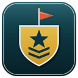

<p align="center"></p>

# Rallypoint

A cross-platform launcher and multiplayer relay for **Command & Conquer: Generals – Zero Hour**: native on macOS and Windows, with a relay server so you can play "LAN" games over the internet.

> **0.1 Beta.** Everything described here is built, but parts have only been tested by the developer so far. See [What works](#what-works-in-01-beta) for an honest list of what is and isn't verified.

You need your own copy of the game (for example *C&C The Ultimate Collection* on Steam). Rallypoint ships no EA game data.

## Features

- **A modern launcher** with a first-run setup wizard that walks you through game files, display, mods and maps.
- **Get the game files from inside the launcher.** On macOS and Linux (where Steam can't install these games) it downloads them for you from your Steam account with a native downloader (no Rosetta needed); on Windows it finds your Steam install.
- **Skirmish / single player.** The game engine is bundled in the app. **Play** opens the full game (Solo Play → Skirmish); **Quick Skirmish** jumps straight into a 1v1 against the AI.
- **Any resolution and aspect ratio.** 4K, HiDPI and ultrawide are supported. The camera keeps the same world scale per pixel, so wide screens see *more* of the map instead of being zoomed in, and the 2D UI is scaled uniformly and centred instead of stretched.
- **Mods made easy.** Press **Get** on a mod, download it in your browser, and Rallypoint installs it automatically. Or drop any mod archive, folder or installer onto the window.
- **Map packs.** One click installs GenTool's ranked 1v1, 2v2 and 3v3 maps (or all of them) into the right folder; you can add any other map archive or folder too.
- **Stays up to date.** The launcher checks GitHub for a newer release when it starts and, if you agree, downloads and opens the installer for your OS.
- **Internet multiplayer through your own server.** Pick a room name and password in the launcher and play the game's normal LAN lobby over the internet.

## What works in 0.1 Beta

| | macOS (Apple Silicon) | Windows | Linux |
|---|---|---|---|
| Launcher | ✅ | ✅ | build it yourself (see [Linux](#linux)) |
| Download game files from Steam | ⚠️ written, not tried with a real account | ✅ finds your Steam install | ⚠️ same as macOS |
| Engine / Skirmish | ⚠️ builds in CI; the upstream port reports Skirmish playable | ⚠️ builds from upstream source, untested here | ❌ not built yet |
| Widescreen / HiDPI patch | ⚠️ written, not played yet | ⚠️ written, not played yet | – |
| Relay server | – | – | ✅ (Docker or binary) |
| Multiplayer through the relay | ⚠️ protocol and launcher agent tested; engine patch **not yet tried in a real game** | same | – |

Legend: ✅ works / tested, ⚠️ implemented but not verified end to end, ❌ missing.

Intel Macs are not supported (the engine port is arm64 only).

## Install

Download the installer for your platform from the [Releases](../../releases) page.

- **macOS:** open the `.dmg` and drag Rallypoint to Applications. The app is ad-hoc signed, not notarised, so Gatekeeper blocks the first launch. Right-click → **Open**, or run `xattr -dr com.apple.quarantine /Applications/Rallypoint.app`.
- **Windows:** run the `-setup.exe`. SmartScreen may warn about an unknown publisher (**More info → Run anyway**).
- **Linux:** there is no Linux installer or game engine yet; see [Linux](#linux). The relay server does run on Linux (below).

### Game data

Rallypoint needs the folder that contains `INIZH.big` (Zero Hour's data).

- **Windows:** Steam installs are found automatically.
- **macOS / Linux:** the setup wizard (or **Settings**) has **Download from Steam**. Enter your Steam account name and password; Rallypoint fetches the open-source [DepotDownloader](https://github.com/SteamRE/DepotDownloader) (checked against a pinned checksum), signs in, and downloads Generals and Zero Hour (about 4 GB). If you use the Steam Mobile app, Steam sends a notification to approve the sign-in; just tap approve (or choose **Enter a code instead**). Email codes are asked for in the launcher. Your password is used only for that sign-in and is never saved. The account must own both games on Steam. It runs natively on Apple Silicon, so Rosetta isn't needed.
- Already have the files somewhere? Choose that folder in the wizard or in **Settings → Game files**.

## Playing

The first time you open Rallypoint, a short **setup wizard** helps you find or download your game files, choose a display setting, and optionally add mods and maps. Online play is set up later from the **Online** tab. You can run the wizard again from **Settings**.

On the Play tab choose a mod (optional), a resolution (it defaults to your screen's native pixels) and fullscreen, then press **Play** for the full menu, or **Quick Skirmish** to drop straight into a match against the AI.

### Mods

Open the **Mods** tab.

1. Press **Get** next to a mod. Your browser opens the mod's official download page; download it (choose the full release, ideally a `.zip` or "no installer" file). Rallypoint spots the finished file in your Downloads folder and installs it by itself.
2. Or **drag and drop** a `.zip`, `.7z`, `.rar`, `.tar.gz`, a folder, or an installer `.exe` onto the window, or paste its path.
3. Pick the mod from the **Mod** list on the Play tab.

Mods are kept in the `Mods` folder inside Rallypoint's data directory and can be removed from the Mods tab (**Open mods folder** shows you where).

| OS | Data directory |
|---|---|
| macOS | `~/Library/Application Support/GeneralsZH/` |
| Windows | `%APPDATA%\GeneralsZH\` |
| Linux | `~/.local/share/GeneralsZH/` |

Why does it open your browser instead of downloading directly? Mod sites such as ModDB don't allow automated downloads, so the launcher links to the official page and picks the file up afterwards. Currently listed: **C&C: Shockwave** and its add-on **C&C: Shockwave Chaos** (it needs Shockwave installed first; Rallypoint lays it over Shockwave when you launch, without changing your Shockwave folder). The add-on setup is untested in a real game. Know another mod that should be listed? Open an issue with its ModDB link.

Unpacking uses tools already on your computer. macOS and Windows can open `.zip` out of the box; for `.7z`, `.rar` and installer `.exe` files you may need `brew install sevenzip innoextract` (macOS), `sudo apt install p7zip-full innoextract unzip` (Linux) or [7-Zip](https://www.7-zip.org/) (Windows). Rallypoint tells you if one is missing. Archives are checked before anything is written, and ones that try to escape their folder are refused.

#### Mods that come as an `.exe`

Many mods ship a Windows installer (and some also a launcher program, or patch the game's own executable). Rallypoint runs a ported engine, so what matters is the mod's **game data** (`.big` files). Your options, best first:

1. **Look for a plain download.** Many mods also offer a `.zip` or "no installer" build. Use that. (Shockwave's own download is an installer in a `.zip` that `innoextract` and 7-Zip can't open, so use option 3: run it on Windows, or in Wine or CrossOver on a Mac, install to a new empty folder, then choose that folder. Shockwave Chaos is a plain `.zip` and installs directly.)
2. **Drop the installer on the window.** If `innoextract` or 7-Zip is installed, Rallypoint unpacks the installer without running it and keeps the game files.
3. **On Windows, run the installer normally**, then drag the folder it installed into onto the Mods tab. Rallypoint copies the game files into its own `Mods` folder.
4. **Unpack it yourself** with `innoextract -d out Setup.exe` or `7z x Setup.exe -oout`, then drop the `out` folder on the window.

What can't work: anything that needs the mod's own program (`.exe`) or a patched `generals.exe` / `game.dat`. The ported engine ignores those, so features that rely on them won't appear, but the mod's `.big` files still load. Mods made only of loose files with no `.big` aren't installed automatically yet. Mods that need the 1.04 patch are fine on the Steam version, which already has it.

### Maps

Zero Hour looks for maps in `Documents/Command and Conquer Generals Zero Hour Data/Maps`. On the **Mods** tab (and in the setup wizard) the **Maps** section installs map packs from [GenTool's download page](https://www.gentool.net/download/): all ranked maps (56 MB), or just the 1v1, 2v2 or 3v3 sets. **Add maps from a file** or **Add a folder of maps** handles any other pack: Rallypoint finds the map folders inside and copies them over. GenTool itself is a Windows-only add-on and isn't needed or installed.

### Updates

At start-up Rallypoint asks GitHub whether a newer release exists (turn this off in **Settings → Updates**). If there is one, a banner offers **Download and open installer**: it fetches the installer for your OS from this repository's release, checks it against the release's `SHA256SUMS`, and opens it. You finish the install yourself, so quit Rallypoint first.

### Widescreen

On by default. Set `GEN_STRETCH=1` in the environment to get the original stretched UI and fixed-horizontal-FOV camera back.

## Multiplayer

Players connect to a Rallypoint server. In the launcher's **Online** box enter the server address, a room name and a room password, then press **Connect** and use the game's LAN lobby. Everyone who uses the same room and password lands in the same game.

While you are connected the Online tab shows how it is going: your latency, jitter and packet loss, the traffic you are sending, and the server's version, uptime, rooms and players in use, and load. The tunnel carries only the game's own network traffic (its lobby and game ports); anything else is dropped, and each player is limited to a sensible packet rate so one client cannot flood a server.

### Run a server

Needs Docker, `make`, and one open **UDP** port (7777 by default).

```bash
git clone https://github.com/michaelmurfy/rallypoint && cd rallypoint
make up
```

| Command | What it does |
|---|---|
| `make config COUNTRIES=NZ` | Create `.env`, optionally limiting the server to one or more countries (`NZ`, `NZ,AU`) |
| `make up` / `make down` / `make restart` | Start, stop, or apply changed settings |
| `make update` | Pull the latest version, refresh the country lists, restart |
| `make logs` / `make status` | Watch the server |

Settings live in `.env` (see [`.env.example`](.env.example)): the port, and `ALLOWED_COUNTRIES` to only accept players from certain countries. The country lists are downloaded for you; local-network addresses are always let through unless you set `ALLOW_PRIVATE=false`.

The image is also published as `ghcr.io/michaelmurfy/rallypoint-relay`, and the release page has a plain Linux binary (`rallypoint-server`).

## Linux

Releases don't include a Linux launcher, and there is no Linux game engine yet (only the relay server runs on Linux). If you want the launcher itself, build it:

```bash
# Debian / Ubuntu build dependencies (other distros: the equivalent webkit2gtk 4.1 / GTK 3 dev packages)
sudo apt install build-essential curl libwebkit2gtk-4.1-dev libgtk-3-dev libayatana-appindicator3-dev librsvg2-dev
git clone --depth 1 https://github.com/michaelmurfy/rallypoint
cd rallypoint
make linux-client            # .deb, .rpm and .AppImage in target/release/bundle/
```

The launcher opens and manages mods, maps and relay rooms, but has no engine to start on Linux.

## Build from source

```bash
git clone --recurse-submodules --depth 1 https://github.com/michaelmurfy/rallypoint
cd rallypoint
cargo test -p generals-core -p generals-proto -p generals-server   # fast tests
make test                                                          # everything, including engine-patch math checks
cargo install tauri-cli --version "^2" --locked
cd launcher/src-tauri && cargo tauri build                         # needs the engine copied into launcher/src-tauri/engine/
```

Building the engine: `sh patches/apply.sh`, then follow `engine/README.md` (macOS: `cmake --preset apple-arm64-release`, target `z_generals`; Windows: `cmake --preset win32`). Details for contributors and AI agents are in [`agent.md`](agent.md).

Releases are built only when a version tag is pushed (`make release VERSION=0.1.0-beta.1`), never on ordinary pushes; see `.github/workflows/release.yml`. Routine pushes run just the fast tests.

### Layout

| Path | What |
|---|---|
| `launcher/` | Tauri 2 app: `core/` (all the logic, tested), `src-tauri/` (thin shell), `ui/` (plain HTML) |
| `server/`, `shared/` | Relay server and the wire protocol crate |
| `engine/` | Git submodule: the macOS/Windows engine port |
| `patches/` | Our engine changes (widescreen, relay transport), applied with `patches/apply.sh` |
| `mods/` | Mod manifest |

## Known limitations

- The engine patches have not been played in a real game by the author yet; widescreen UI details and the relay transport are the most likely places to find bugs. Please file issues.
- No Linux engine, no Intel Mac engine.
- The Steam download has not been tried against a real account yet, and mods can't be downloaded from inside the launcher.
- Planned but not started: saving and loading multiplayer games, controlling allied units, and co-op (sharing one player and its units).
- Relay traffic is not encrypted, so someone on the network path could read or replay it; room passwords keep other players out, not eavesdroppers.
- Game determinism between macOS and Windows (the classic Generals desync problem) has not been tackled yet.

## Credits and legal

Rallypoint stands on [Electronic Arts' GPL release of the Generals source](https://github.com/electronicarts/CnC_Generals_Zero_Hour), [TheSuperHackers/GeneralsGameCode](https://github.com/TheSuperHackers/GeneralsGameCode) and the [macOS port by dvcdsys](https://github.com/dvcdsys/GeneralsGameCode-macOS). The engine and our engine patches are GPL-3.0 with EA's additional terms (see `engine/LICENSE.md`). This project is not endorsed by or affiliated with Electronic Arts. *Command & Conquer* and *Generals* are trademarks of EA. The launcher, relay server and scripts in this repository are MIT licensed (see [`LICENSE`](LICENSE)). The engine in `engine/` and our changes to it in `patches/` are GPL-3.0 with EA's additional terms ([`patches/LICENSE.md`](patches/LICENSE.md)); the launcher runs the engine as a separate program. Steam downloads use the open-source (GPL-2.0) [DepotDownloader](https://github.com/SteamRE/DepotDownloader), fetched at runtime and not bundled. Release downloads bundle the engine, and its complete source is `engine/` at the tagged commit plus `patches/`.
